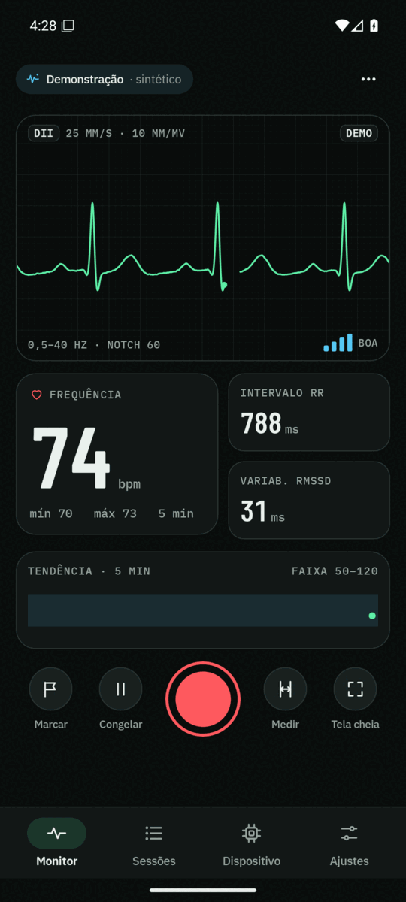
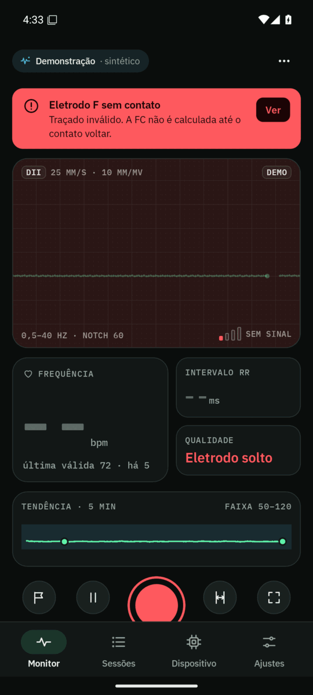
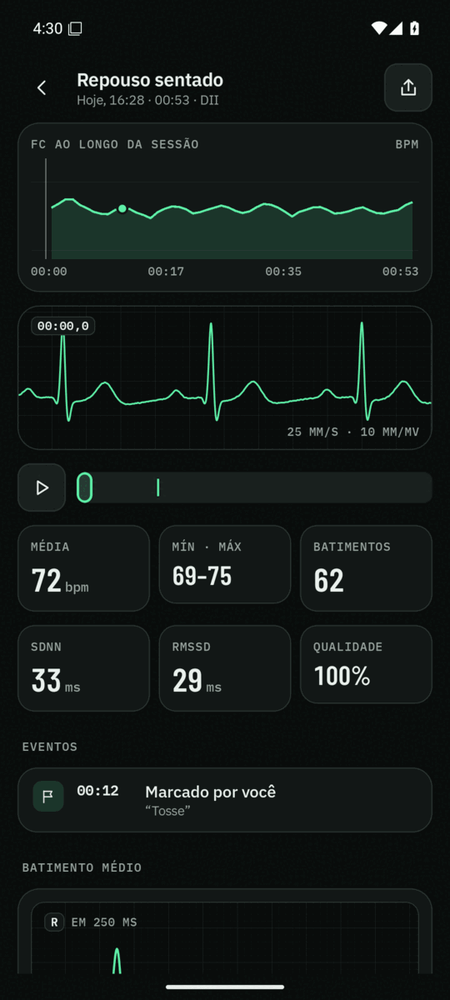
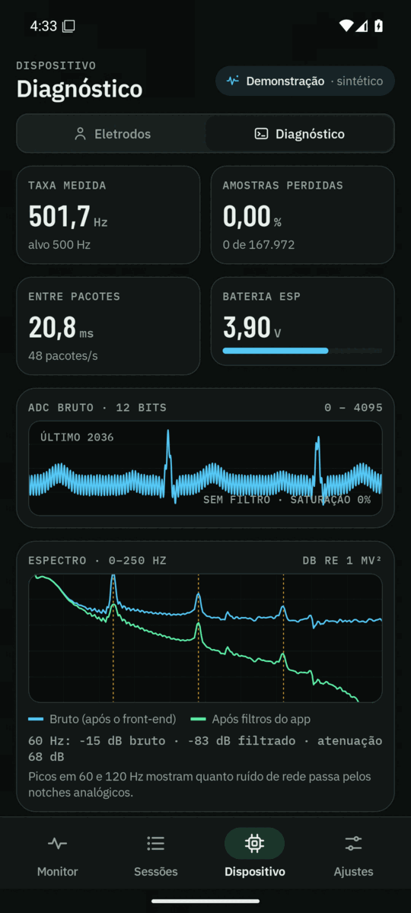
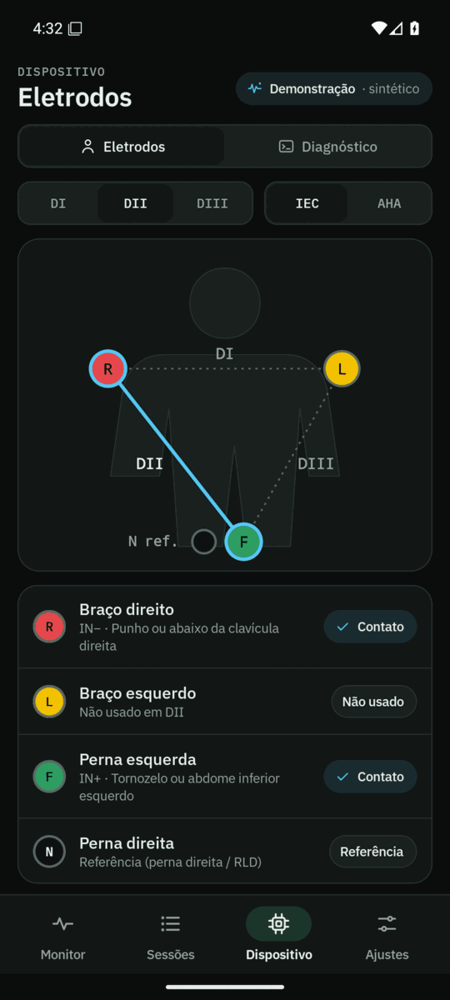
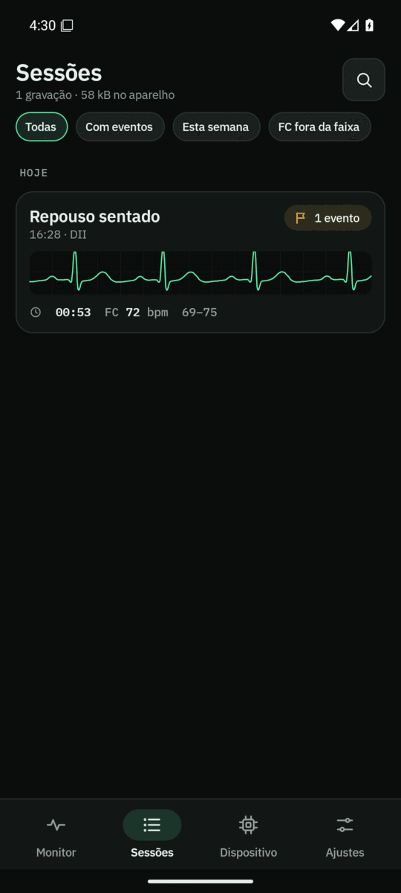
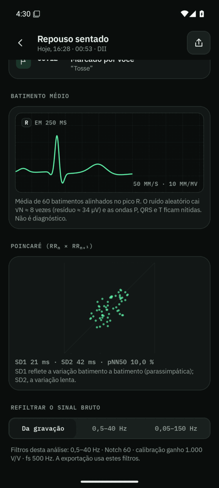
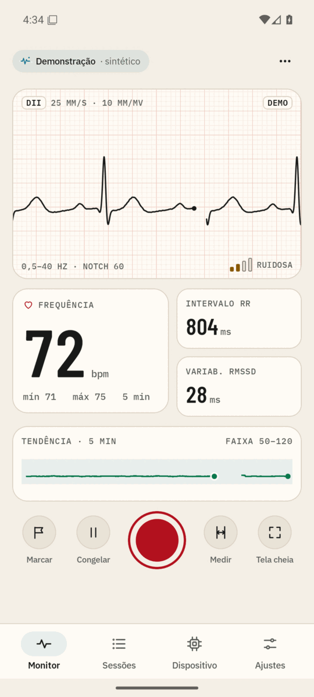
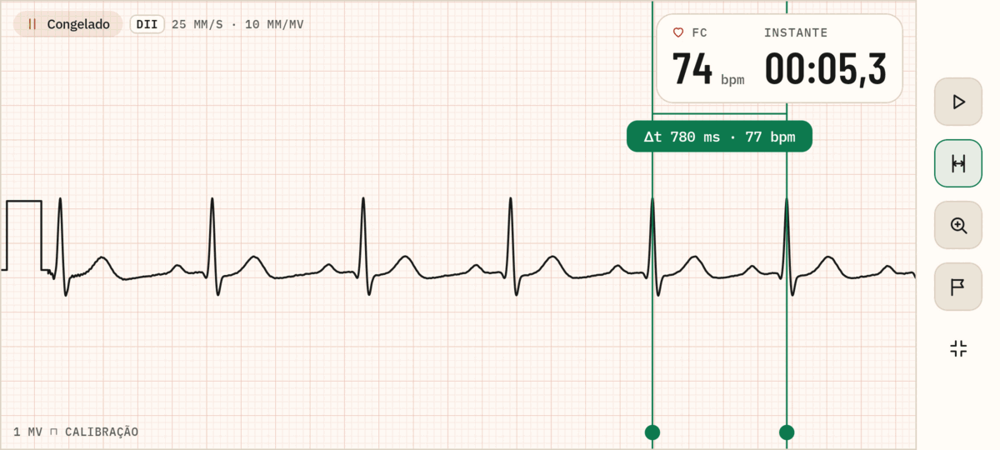

# Sístole — app Android do ECG

Visualização, gravação e análise do sinal do ECG da disciplina EEE025. Recebe as amostras do ESP32 por
**Bluetooth LE** ou **USB serial (OTG)**, ou gera um sinal sintético no **modo Demo**.
O plano completo das funcionalidades está em [PLANO.md](PLANO.md); o firmware de referência em
[`../Firmware`](../Firmware/README.md).

> Uso didático. Não é equipamento médico.

| Monitor | Eletrodo solto | Revisão | Diagnóstico |
| --- | --- | --- | --- |
|  |  |  |  |
| **Eletrodos** | **Sessões** | **Batimento médio** | **Tema Papel** |
|  |  |  |  |



## Compilar

Requisitos: JDK 17 ou mais novo e o Android SDK (plataforma 37). No Android Studio basta abrir a pasta `App/`.
Pela linha de comando:

```bash
cd App
./gradlew assembleDebug        # gera app/build/outputs/apk/debug/app-debug.apk
./gradlew testDebugUnitTest    # testes de DSP, protocolo, análise e exportação
./gradlew installDebug         # instala no celular conectado (depuração USB ligada)
```

Se o SDK não estiver em `~/Android/Sdk`, crie `App/local.properties` com `sdk.dir=/caminho/do/sdk`.

## Usar

1. Na primeira abertura, leia o aviso de uso.
2. **Monitor → Conectar**:
   - *Bluetooth*: o app procura aparelhos que anunciam o serviço Sístole (desligue "Só Sístole" para ver todos).
   - *USB*: ligue o ESP32 com cabo OTG, toque em "Abrir porta serial" e aceite a permissão. Plugar o cabo abre o app.
   - *Demo*: sinal sintético com FC escolhida, ruído de 60 Hz e eletrodo solto simulados.
3. **Ajustes → Calibração do front-end**: informe o ganho total do circuito e o offset na entrada do ADC para o
   app mostrar mV reais no eletrodo (padrão: ganho 1000, offset 1,65 V, Vref 3,3 V).
4. Grave pelo botão vermelho; marque eventos com "Marcar". As sessões ficam em **Sessões** e podem ser revistas,
   refiltradas e exportadas em PDF, CSV ou EDF+.

## Organização do código

```text
app/src/main/java/br/ufmg/sistole/
├── dsp/        filtros biquad, Pan-Tompkins, HRV, FFT/Welch, ECG sintético
├── source/     protocolo (CSV, binário, pacote BLE), fontes BLE / USB / Demo, ConnectionManager
├── engine/     AcquisitionEngine: calibração, filtros, QRS, qualidade, alarmes, gravação
├── data/       ajustes, sessões em disco (meta.json + samples.bin) e análise offline
├── export/     PDF (papel milimetrado 25 mm/s), CSV e EDF+
└── ui/         tema com os tokens do design system, componentes e telas
```

O traçado ao vivo usa o DPI físico da tela, então 25 mm/s e 10 mm/mV são milímetros reais.
A gravação guarda o ADC bruto (int16) e toda análise é refeita a partir dele.

## Limitações conhecidas

- A aquisição roda enquanto o app está aberto (não há serviço em segundo plano).
- O lead-off só aparece se o firmware enviar LO+/LO−; sem isso, o app usa saturação e sinal plano como indícios.
- BLE e USB não foram testados com o hardware ainda: só o modo Demo rodou no emulador.
